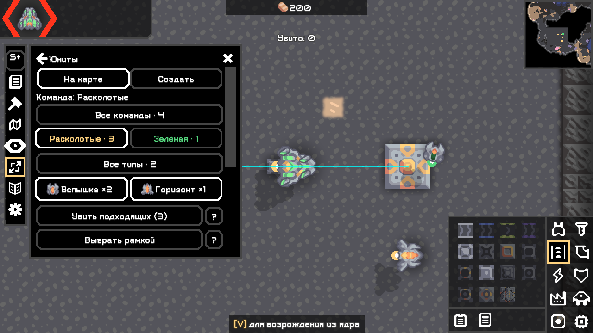

# Size Plus (S+)

Схемы и быстрый доступ, импорт изображений, строительные инструменты, визуальные слои и локальный прогноз маршрутов противников по клеткам.

**[Скачать JAR](https://github.com/FallAvalon/scheme-size-plus/releases/latest)** · [Руководство](USER_GUIDE_RU.md) · [Сообщить об ошибке](https://github.com/FallAvalon/scheme-size/issues)

## Совместимость

Mindustry **V8 Build 160.7**, настольные Windows/Linux. Windows проверен, Linux пока не проверен. Android не поддерживается.

**Тестовая версия 0.4.1.** Полный паритет с Scheme-Size 2.7.79 не подтверждён. Основной сетевой сценарий — мод у встроенного хоста, гости без модов; проверенные действия и ограничения перечислены в отчётах. WAN пока не проверен.

## Установка

1. Скачайте `scheme-size-plus.jar` из Releases.
2. Модификации → Импортировать модификацию → выберите JAR.
3. Перезапустите игру. Инструменты — на панели S+/SG слева; справка — кнопки ?.

Обычно достаточно одной редакции: God включает общие инструменты Plus. Начните с отдельного тестового мира. До появления в каталоге используйте JAR с диска; прямой GitHub-импорт этой витрины может распознать её как ZIP-мод.

## Интерфейс

Юниты → На карте → команда → типы по иконкам → красная кнопка с названием и количеством целей. Можно выбрать несколько типов, рамку или отдельных юнитов. Управляемые игроками юниты исключаются повторно при исполнении. Native смерть может вызвать побочный урон.

## Исходники и проверки

Это витрина сборок из общей кодовой базы. Исходники: https://github.com/FallAvalon/scheme-size/tree/3aa9e73865e08dccceda2ffa02f0c7a45f522934

[Матрица реализации](https://github.com/FallAvalon/scheme-size/blob/3aa9e73865e08dccceda2ffa02f0c7a45f522934/reports/02_o279_implementation_matrix.md) · [Проверки 0.4.1](https://github.com/FallAvalon/scheme-size/blob/3aa9e73865e08dccceda2ffa02f0c7a45f522934/reports/19_cursor_teleport.md) · [История сетевых проверок](https://github.com/FallAvalon/scheme-size/blob/3aa9e73865e08dccceda2ffa02f0c7a45f522934/reports/16_roster_icon_publication.md).

Исходный коммит и хеш манифеста указаны в source.json; к релизу приложен SHA256SUMS.txt. Это самостоятельная реализация, не официальный выпуск оригинального Scheme-Size.
